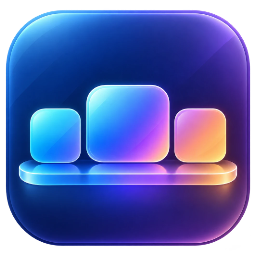

# Tasky

A floating dock for Windows 11. It sits at the bottom, top, left or right of the screen in place of the Windows taskbar, with your pinned and running apps, a system tray, Quick Settings and a clock.


**[Download the latest release](https://github.com/Dharun1704/Tasky/releases/latest)**, but please read the next section first.

## Read this first

> [!WARNING]
> **Tasky replaces the Windows taskbar.** While it runs, the normal taskbar is hidden and Tasky takes over the system tray. **Exiting Tasky (right-click the dock → Exit Tasky) always brings the normal taskbar back.** If Tasky ever crashes, see [Getting the Windows taskbar back](#getting-the-windows-taskbar-back).

> [!WARNING]
> **Windows will warn you before it first runs.** Tasky isn't code-signed (that needs a paid certificate), so Windows SmartScreen says *"Windows protected your PC"*. Click **More info → Run anyway**. Some antivirus programs may also flag it, because hiding the taskbar and taking over the tray look unusual. The full source code is here if you want to check what it does, or build it yourself.

> [!IMPORTANT]
> **It relies on parts of Windows that Microsoft doesn't document:** the blur behind the dock, taking over the tray, hiding the taskbar, and moving Start and Quick Settings above the dock. A Windows update (Insider builds especially) can break one of them until Tasky is updated.

> [!NOTE]
> Tasky is a personal, open-source project, offered as is and without warranty (see the [licence](LICENSE)). Bug reports are welcome in [Issues](https://github.com/Dharun1704/Tasky/issues).

**Known limitations**

- **Windows 11 (64-bit) only.** Windows 10 isn't supported: the blur and rounded corners need Windows 11.
- **One dock, on one display** (choose which in settings). The Windows taskbar is only hidden on the main display.
- **Apps flashing for attention:** this version of Windows doesn't tell Tasky when most apps flash, so the dock doesn't pop up for them. Permission prompts (User Account Control) are detected and do bring it up.
- **Dock on the top, left or right:** Quick Settings opens in Windows' own spot (bottom right) rather than next to the dock.
- **Tray icons of apps running as administrator** only respond if Tasky also runs as administrator.
- **Tray icons of apps that were already running** appear once the app re-adds them; restart any that don't show up.
- **Jump lists:** right-click menus show an app's recent files, but not the custom tasks some apps add (Windows only shares those with its own taskbar).
- **Other docks and toolbars** that reserve screen space the way the taskbar does can't while Tasky shows the tray.

## Features

- **Apps:** pinned and running apps in one row. Icons grow as the mouse passes over them, a dot marks running apps and a bar marks the one in front. Drag pinned icons to reorder them.
- **Lots of apps:** when they don't all fit, the icons shrink to fit the screen, and past that the extra running apps move into a **…** menu.
- **Previews:** hover a running app to see live thumbnails of its windows; click one to switch to it, or close it from there.
- **Recent files:** right-click an app for the documents and folders you used in it recently.
- **Glass:** a rounded, see-through dock with real blur behind it, in a dark or light theme (or matching Windows).
- **Out of the way:** keep windows above the dock, let it hide whenever a window overlaps it, or keep it always on top. It also steps aside for fullscreen games and videos, and comes back out when Windows asks for permission (User Account Control).
- **Tray:** apps' tray icons (OneDrive, Discord, Bluetooth…) live in the dock. Pin the ones you use; the rest wait behind the arrow.
- **Windows bits:** Start button, live Wi-Fi, volume and battery icons that open Quick Settings, and a clock that opens the notification center.
- **Settings:** a Windows 11-style settings window for the look (theme, blur, opacity, roundness, clock size, animation speed), size and position (icon size, spacing, magnification, screen edge, display) and behaviour. Changes show on the dock as you make them.
- **Starts quickly:** with "Start with Windows" on, Tasky starts as soon as you sign in, and the normal taskbar is there until it does.

## Contents

- [Read this first](#read-this-first)
- [Features](#features)
- [Install](#install)
- [Using Tasky](#using-tasky)
- [Settings](#settings)
- [Getting the Windows taskbar back](#getting-the-windows-taskbar-back)
- [Uninstall](#uninstall)
- [For developers](#for-developers)
- [Licence](#licence)

## Install

1. **Download** one of the two zips from the **[latest release](https://github.com/Dharun1704/Tasky/releases/latest)**:

   | Download | Size | Needs |
   | --- | --- | --- |
   | `Tasky-<version>-win-x64.zip` | ~3 MB | The free [.NET 10 Desktop Runtime](https://dotnet.microsoft.com/download/dotnet/10.0) (x64), installed once |
   | `Tasky-<version>-win-x64-standalone.zip` | ~65 MB | Nothing: it includes .NET |

   To install the runtime from a terminal instead:
   ```bash
   winget install Microsoft.DotNet.DesktopRuntime.10
   ```
2. **Unzip it to a folder it can stay in**, for example `%LOCALAPPDATA%\Programs\Tasky`. Starting with Windows runs it from there, so don't leave it in Downloads if you clear that out.
3. **Run `Tasky.exe`.** If SmartScreen warns you, click **More info → Run anyway** (see [Read this first](#read-this-first)). The dock appears at the bottom of the screen and the Windows taskbar hides.
4. Optional: click the **gear** on the dock → **System**, and turn on **Start with Windows** and **Show Tasky in the Start menu**.

Settings, pins and an error log are kept in `%APPDATA%\Tasky`.

**Updating:** exit Tasky (right-click the dock → **Exit Tasky**), replace `Tasky.exe` with the one from the new release, and start it again. Your settings stay in `%APPDATA%\Tasky`.

## Using Tasky

**App icons**

| Action | What happens |
| --- | --- |
| Hover | Shows live previews of the app's windows. Click a preview to switch to that window, or **×** to close it. |
| Click | Opens a pinned app, brings a running app to the front, or minimizes it if it's already in front. Apps with several windows cycle through them. |
| Middle-click | Opens a new window. |
| Right-click | Recent files and folders, the app's windows, plus **New window**, **Pin / Unpin** and **Close**. |
| Drag a pinned icon sideways | Moves it. |
| Drag an `.exe` or shortcut onto the dock | Pins it. |

**The rest of the dock**

- **Start button:** opens the Start menu. The Windows key works too, and brings up a hidden dock.
- **Arrow (^):** shows every tray icon. Hover one and click its pin to keep it on the dock; drag pinned tray icons to reorder them. Clicks, right-clicks and double-clicks on tray icons go to the app, just like the Windows tray.
- **Wi-Fi / volume / battery:** show signal strength, volume or mute, and charge as they change (hover for the details). Click to open Windows Quick Settings right above the dock.
- **Clock:** opens the notification center and calendar.
- **Gear:** opens Tasky's settings. Right-clicking empty space on the dock gives a quick menu with the dock modes and **Exit Tasky**.

**Ctrl + Alt + D** shows a hidden dock (it can be turned off in settings). Launching `Tasky.exe` while it's already running opens its settings.

## Settings

| Page | Options |
| --- | --- |
| Appearance | Theme (match Windows, dark, light), blur, background opacity, corner roundness, clock size, animation speed |
| Size & position | Icon size, space between icons, magnify on hover, magnification amount, screen edge (bottom, top, left or right), distance from the screen edge, which display the dock is on |
| Behavior | Dock mode (below), reveal delay, hide delay, the Ctrl + Alt + D shortcut |
| System | Show tray icons, hide the Windows taskbar, start with Windows, Start menu shortcut |
| About | Version, a link to this page, and the folder with Tasky's settings |

**Dock modes**

- **Keep windows above the dock:** maximized windows stop where the dock starts, like with the normal taskbar.
- **Hide when a window overlaps:** the dock slides away under windows. Push the mouse to the bottom edge, or press the Windows key, to bring it back.
- **Always show over windows:** the dock stays on top.

With blur on, Windows only allows square, 4 px or 8 px corners on the blurred area, so the roundness slider snaps to those. Turn blur off for any roundness.

## Getting the Windows taskbar back

- **Exit Tasky** (right-click the dock) restores the taskbar, its auto-hide setting and the tray icons.
- If Tasky crashed or was ended from Task Manager, start it and exit it again, or turn off **Hide the Windows taskbar** in its settings.
- Restarting Windows Explorer (Task Manager → *Windows Explorer* → **Restart**) also brings the taskbar back.
- After a restart, the taskbar is always there until Tasky starts.

## Uninstall

1. In Tasky's settings → **System**, turn off **Start with Windows** and **Show Tasky in the Start menu**. (Start with Windows is a task in Task Scheduler named *Tasky*; you can also delete it there.)
2. Exit Tasky (right-click the dock → **Exit Tasky**). The Windows taskbar comes back with your own settings.
3. Delete Tasky's folder, and `%APPDATA%\Tasky` to remove its settings too.

## For developers

**Building from source** needs the [.NET 10 SDK](https://dotnet.microsoft.com/download/dotnet/10.0) (`winget install Microsoft.DotNet.SDK.10`). From the repository folder, this puts a single `Tasky.exe` in `publish`:

```bash
dotnet publish -c Release -o publish
```

For the standalone build that includes .NET, add `-p:SelfContained=true`.

To build and run a debug copy while working on it:

```bash
dotnet run
```

Exit any running copy first: Tasky allows only one at a time, and a second copy just opens the running one's settings and quits. To open the settings window straight away:

```bash
dotnet run -- --settings
```

The **[developer guide](docs/DEVELOPER.md)** explains how Tasky works and walks through every file. It starts with a C# and WPF primer for C++ and Win32 developers.

## Licence

Tasky is free software under the [GNU General Public License v3.0](LICENSE).

It uses [ManagedShell](https://github.com/cairoshell/ManagedShell) (Apache License 2.0) for the system tray.
