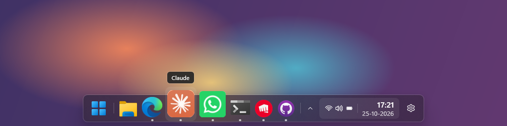

# Tasky

A floating dock for Windows 11. It sits at the bottom of the screen in place of the Windows taskbar, with your pinned and running apps, a system tray, Quick Settings and a clock.



- **Apps:** pinned and running apps in one row. Icons grow as the mouse passes over them, a dot marks running apps and a bar marks the one in front.
- **Glass:** a rounded, see-through dock with real blur behind it.
- **Out of the way:** keep windows above the dock, let it hide whenever a window overlaps it, or keep it always on top. It also steps aside for fullscreen games and videos.
- **Tray:** apps' tray icons (OneDrive, Discord, Bluetooth…) live in the dock. Pin the ones you use; the rest wait behind the arrow.
- **Windows bits:** Start button, Quick Settings (wifi, volume, battery) and a clock that opens the notification center.
- **Settings:** sliders for icon size, spacing, magnification, corner roundness, opacity, clock size and distance from the screen edge. Changes show on the dock as you make them.

> **Heads-up:** Tasky leans on parts of Windows that Microsoft doesn't document: the blur, taking over the system tray, hiding the taskbar and placing Quick Settings. A Windows update (Insider builds especially) can break one of them. **Exit Tasky always gives you the normal Windows taskbar back.**

## Contents

- [Requirements](#requirements)
- [Install](#install)
- [Using Tasky](#using-tasky)
- [Settings](#settings)
- [Getting the Windows taskbar back](#getting-the-windows-taskbar-back)
- [Known limitations](#known-limitations)
- [For developers](#for-developers)
- [Licence](#licence)

## Requirements

- **Windows 11.** Windows 10 isn't supported: the blur and the rounded corners need Windows 11.
- **[.NET 10 SDK](https://dotnet.microsoft.com/download/dotnet/10.0)** (x64), to build Tasky. Or install it from a terminal:
  ```bash
  winget install Microsoft.DotNet.SDK.10
  ```

## Install

Tasky is built from source.

1. **Get the code:** clone the repository, or on GitHub click **Code → Download ZIP** and unzip it.
   ```bash
   git clone https://github.com/Dharun1704/Tasky.git
   ```
2. **Build it** from inside the downloaded folder (`Tasky`, or `Tasky-main` if you used the ZIP). This puts a ready-to-run copy in `publish`:
   ```bash
   dotnet publish -c Release -o publish
   ```
3. **Start it:** double-click **`publish\Tasky.exe`**. The dock appears at the bottom of the screen.
4. Optional: click the **gear** on the dock and turn on **Start with Windows**.

Settings, pins and an error log are kept in `%APPDATA%\Tasky`.

**Updating:** exit Tasky (right-click the dock → **Exit Tasky**), get the new code (`git pull`, or download the ZIP again), run the same `dotnet publish` command, and start `publish\Tasky.exe`. Your settings stay in `%APPDATA%\Tasky`.

## Using Tasky

**App icons**

| Action | What happens |
| --- | --- |
| Click | Opens a pinned app, brings a running app to the front, or minimizes it if it's already in front. Apps with several windows cycle through them. |
| Middle-click | Opens a new window. |
| Right-click | Lists the app's windows, plus **New window**, **Pin / Unpin** and **Close**. |
| Drag an `.exe` or shortcut onto the dock | Pins it. |

**The rest of the dock**

- **Start button:** opens the Start menu. The Windows key works too, and brings up a hidden dock.
- **Arrow (^):** shows every tray icon. Hover one and click its pin to keep it on the dock. Clicks, right-clicks and double-clicks on tray icons go to the app, just like the Windows tray.
- **Wifi / volume / battery:** opens Windows Quick Settings, right above the dock.
- **Clock:** opens the notification center and calendar.
- **Gear:** opens Tasky's settings. Right-clicking empty space on the dock gives a quick menu with the dock modes and **Exit Tasky**.

Launching `Tasky.exe` while it's already running opens its settings.

## Settings

| Section | Options |
| --- | --- |
| Size | Icon size, space between icons, magnify on hover, magnification amount |
| Look | Corner roundness, background opacity, blur, clock size, distance from the screen edge |
| Behavior | Dock mode (below), show tray icons, hide the Windows taskbar, start with Windows |

**Dock modes**

- **Keep windows above the dock:** maximized windows stop where the dock starts, like with the normal taskbar.
- **Hide when a window overlaps:** the dock slides away under windows. Push the mouse to the bottom edge, or press the Windows key, to bring it back.
- **Always show over windows:** the dock stays on top.

With blur on, Windows only allows square, 4 px or 8 px corners on the blurred area, so the roundness slider snaps to those. Turn blur off for any roundness.

## Getting the Windows taskbar back

- **Exit Tasky** (right-click the dock) restores the taskbar, its auto-hide setting and the tray icons.
- If Tasky crashed or was ended from Task Manager, start it and exit it again, or turn off **Hide the Windows taskbar** in its settings.
- Restarting Windows Explorer (Task Manager → *Windows Explorer* → **Restart**) also brings the taskbar back.

## Known limitations

- Primary monitor only.
- While Tasky shows the tray, other apps that reserve screen space the way the taskbar does (other docks and toolbars) can't.
- Tray icons of apps running as administrator only respond if Tasky also runs as administrator.
- Tray icons from apps that were already running appear once the app re-adds them; restart any that don't show up.

## For developers

Tasky is C# / WPF on .NET 10. To build and run a debug copy while working on it:

```bash
dotnet run
```

Exit any running copy first: Tasky allows only one at a time, and a second copy just opens the running one's settings and quits. To open the settings window straight away:

```bash
dotnet run -- --settings
```

| File | What it does |
| --- | --- |
| `MainWindow.xaml(.cs)` | The dock: layout, magnification, auto-hide, clicks, menus, tray UI |
| `WindowEnumerator.cs` | Finds taskbar-worthy windows and groups them by app |
| `IconLoader.cs` | High-quality app icons at every size the dock draws |
| `BackdropWindow.cs` | The blur behind the dock |
| `TrayHost.cs` | The system tray, via [ManagedShell](https://github.com/cairoshell/ManagedShell) |
| `Shell.cs` | Reserving screen space, hiding the Windows taskbar, start with Windows |
| `SettingsWindow.xaml(.cs)` | The settings window |

## Licence

Tasky is free software under the [GNU General Public License v3.0](LICENSE).

It uses [ManagedShell](https://github.com/cairoshell/ManagedShell) (Apache License 2.0) for the system tray.
